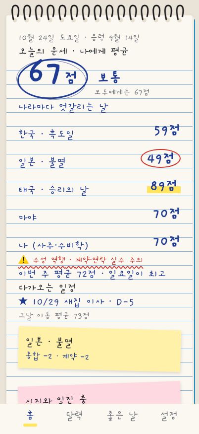
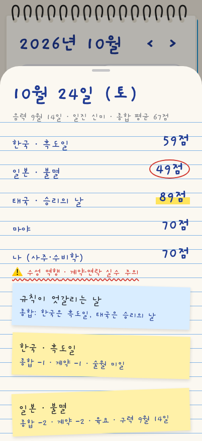
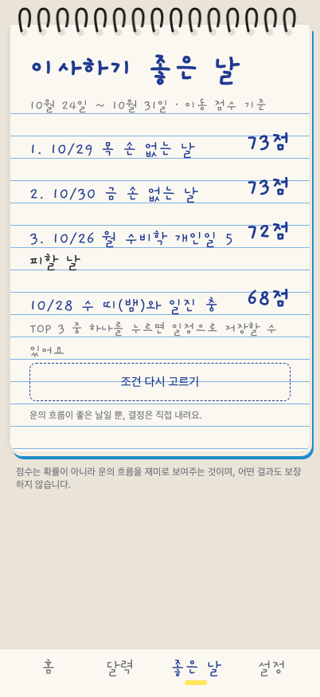
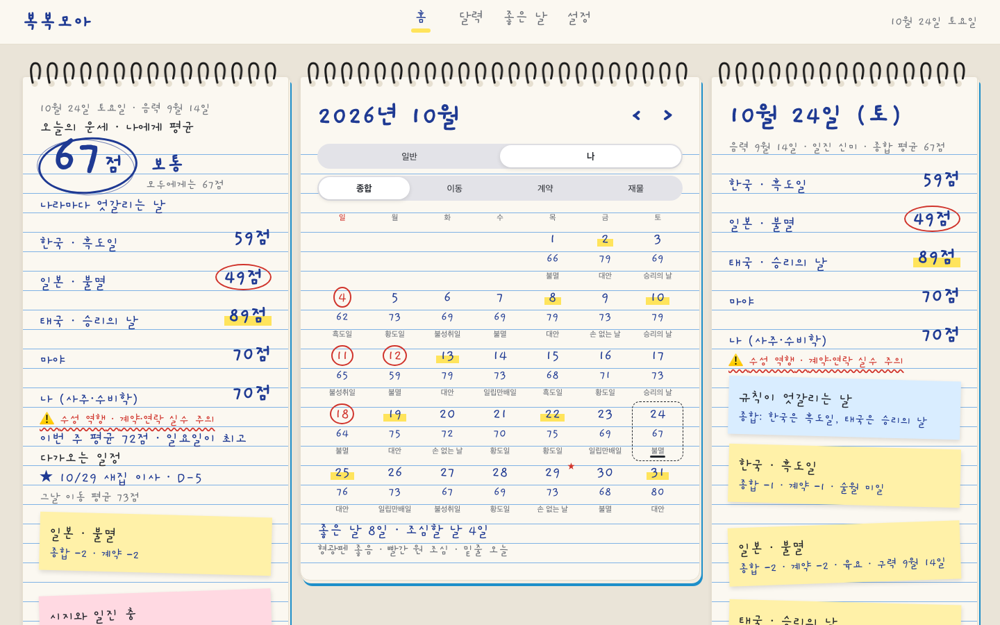

# 복복모아 (BokBokMoa)

**복복모아**는 온 세상의 좋은 기운을 모아모아, 나에게 좋은 날을 달력에 담는 운세 캘린더 웹사이트입니다. 아이폰·아이패드·컴퓨터 화면 크기에 맞춰 레이아웃이 바뀝니다. 한국의 손 없는 날·길일, 일본의 육요·일립만배일, 태국의 승리의 날, 마야 260일 달력처럼 나라마다 흩어진 날짜 규칙으로 나라별 운세 점수(100점 만점)와 그 평균, 근거를 보여줍니다. 서양의 13일의 금요일·수성 역행은 조심 알림으로 띄웁니다. 생년월일시를 입력하면 내 사주·수비학 점수까지 더한 맞춤 달력을, 건너뛰면 누구에게나 같은 일반 길일 달력을 보여줍니다. 로그인은 없습니다.

## 목적과 대상

- **대상**
  - 오늘 하루 운세를 가볍게 확인하고 싶은 사람
  - 이사·계약·개업 등 중요한 일을 앞두고 좋은 날을 찾고 싶은 사람
- **불편함**: 운세 앱과 달력 앱이 따로 놀고, 나라별 길일 규칙을 따로 찾아봐야 하며, 규칙끼리 엇갈려도 알 수 없음
- **재미 포인트**: 흩어진 민속 전통과 내 사주를 점수 하나와 그 근거로 투명하게 보여주기
- **배경**: AI로 운세를 보는 사람이 늘고, 복권 1등 당첨 후기가 릴스로 퍼지면서 좋은 날을 챙기는 문화가 커진 흐름. 일본에서 복권 판매점 앞에 길일이 붙어 있는 것을 본 개인적인 관찰에서 착안

## 핵심 기능

1. **온보딩**: 생년월일시 입력(시간 모름 가능) 또는 건너뛰기. 입력값은 기기에만 저장
2. **홈 (오늘의 운세)**: 종합 점수(0~100), 한 줄 요약, 분야별(종합·이동·계약·재물) 점수, 개인 모드면 일반 점수와 내 점수 비교, 다가오는 내 일정 D-day
3. **운세 달력**: 날짜별 점수 색, 분야 필터, 일반/나 전환, 일정 표시
4. **근거 카드**: 어떤 나라의 어떤 규칙, 사주의 어떤 관계가 점수를 올리고 내렸는지 보여주고, 규칙끼리 엇갈리면 함께 안내
5. **좋은 날 찾기**: 일 종류(이사·계약·개업/투자·기타)와 기한(이번 주·이번 달·3개월)을 고르면 좋은 날 TOP 3와 피할 날을 보여주고, 고른 날을 일정으로 저장
6. **일정 내보내기**: 저장한 일정을 `.ics` 파일로 받아 iOS 캘린더에 넣기 (그날 점수와 근거가 메모로 들어감)
7. **화면 크기별 레이아웃**: 아이폰은 아래 탭 바와 한 화면 한 기능, 아이패드 가로는 달력·상세 2단(세로는 1단 + 아래 시트), 컴퓨터는 3단 한 화면. 아이폰·아이패드에서는 홈 화면에 추가해 앱처럼 열기

| 아이폰 홈 | 날짜 상세 (근거 카드) | 좋은 날 찾기 결과 | 컴퓨터 3단 |
| --- | --- | --- | --- |
|  |  |  |  |

화면 크기별 스크린샷 전체는 [docs/screenshots/2026-10-24](docs/screenshots/2026-10-24)에 있습니다.

## 배포

**https://bokbokmoa.vercel.app** (Vercel, 정적 사이트). 디자인 비교: https://bokbokmoa.vercel.app/compare.html

## 실행 방법

Node.js 20.19 이상(또는 22.12 이상)이 필요합니다.

```bash
npm install
npm run dev      # 개발 서버 (http://localhost:5173)
npm test         # 테스트 (vitest)
npm run build    # 타입 검사 + dist/ 에 정적 사이트 빌드
npm run preview  # 빌드 결과 미리보기
```

- 서버와 로그인이 없는 정적 사이트입니다. 생년월일시와 일정은 브라우저 localStorage에만 저장됩니다.
- 디자인 비교: `/compare.html`에서 다섯 디자인(기본 스프링 메모장 · 한지 · 미니멀 · 다이어리 · 픽셀)을 기기 크기별로 나란히 볼 수 있습니다. 앱 주소에 `?design=hanji`처럼 붙여도 바뀝니다.
- 규칙만 빠르게 확인하려면 Claude Code에서 `/fortune 1993-02-28 05:30 --date 2026-11-13` 처럼 스킬을 부릅니다 (`.claude/skills/fortune`).

## 작업 과정

| 날짜 | 한 일 |
| --- | --- |
| ~10/20 | [PRD.md](PRD.md) 작성. 배경·범위·규칙표·점수 계산·완료 기준·리스크를 먼저 정함 |
| 10/20 | 오픈 질문 8개(신호 값, 음력 라이브러리, 자시 기준, 개인 규칙 상한, 색 경계값, "기타" 분야, 아이패드 세로, 배포)를 기존 운세·만세력·길일 달력 앱을 참고해 결정하고 PRD "결정 사항"에 근거와 함께 기록. 나라별 점수를 하나로 합치지 않고 출처별 100점 + 평균으로 바꿈 |
| 10/20 | `/fortune` 스킬로 점수 규칙 시제품을 먼저 만들어, 화면 없이 날짜별 점수와 근거를 확인하며 신호 값과 등급 경계를 맞춤 |
| 10/24 | Figma에 디자인 시스템(스프링 메모장 + 손글씨) 정리, 손글씨 글꼴을 개구로 결정 |
| 10/24 | 시제품 계산을 `src/fortune`으로 옮기고, 스킬 결과와 같은 값이 나오는지 테스트로 고정. 화면 6개와 세 가지 레이아웃, 홈 화면에 추가(매니페스트·아이콘) 구현. 글자와 버튼은 메모장의 28px 줄에 맞춤 |
| 10/24 | `.ics` 내보내기, 디자인 버전 비교 페이지, 기기 크기별 스크린샷 |
| 11/1 | Vercel 프로덕션 배포 (https://bokbokmoa.vercel.app) |

## Claude Code 사용 증거와 검증 결과

**Claude Code를 쓴 곳**

- PRD의 오픈 질문을 기존 앱·라이브러리 조사로 정리하고 결정 근거를 표로 기록 (커밋 `f522953`)
- 규칙 시제품을 프로젝트 스킬로 만들어 대화 중에 바로 점수를 확인 (`.claude/skills/fortune`, 커밋 `a861a5b`)
- 사이트 구현, 테스트 작성, 화면 크기별 스크린샷 촬영 (커밋 `f984c9a`, `7b4f7c6`)
- 위 커밋들에 `Co-Authored-By: Claude` 표기

**테스트 결과** (`npm test`, 2026-11-01): 테스트 파일 2개, 테스트 22개 모두 통과

| 묶음 | 확인한 것 | 대조 기준 |
| --- | --- | --- |
| 일본 규칙 | 2026년 1월의 대안(1·7·13·24·30일), 불성취일(1·9·17·24일), 일립만배일 | 일본 길일 달력 bestcalendar.jp |
| 한국·태국·마야·서양 | 손 없는 날(음력 끝자리 9·0), 태국 กาลโยค 표 밖의 날은 태국 점수 제외, 2012-12-21 = 4 아하우, 서양 규칙은 점수 없이 알림만 | 음력 변환 결과, 태국 언론 길일 기사, GMT 상관 상수 |
| 점수 | 2026-10-24 한국 59 · 일본 49 · 태국 89 · 마야 70 → 평균 67, 엇갈림 분야(종합·계약), 1년 내내 40점 밑으로 안 내려감, 등급 경계 74/65 | `/fortune` 스킬 결과 |
| 사주 | 음력 1992-09-29 05:30 → 임신·경술·계유·을묘, 시간 모름이면 세 기둥, 수비학 개인일, 개인 모드에서 "나"가 다섯 번째 출처 | manseryeok README 예시 |
| **edge case: 윤달** | 윤6월이 낀 2025년 7~8월도 빈칸 없이 하루씩 계산, 음력 윤4월 1일(2020)생 → 양력 2020-05-23 | KASI 음력 |
| **edge case: 사주 경계** | 입춘(2024-02-04 17:27) 전 10시생은 계묘(토끼), 후 20시생은 갑진(용). 밤 11시 반생도 날은 자정에 바뀜(정자시) | KASI 절기 시각 |
| **edge case: 규칙 엇갈림** | 2026-10-24는 태국이 좋음, 일본이 조심이라 종합·계약에 엇갈림 안내가 뜸 | 점수 테스트 |
| `.ics` | 하루 종일 일정, 연말 다음 날 넘김(12/31 → 1/1), 쉼표·줄바꿈 이스케이프, 75바이트 줄 접기(한글 안 깨짐), CRLF | RFC 5545 |

**화면 확인**: 아이폰(402px), 아이패드 세로(820px)·가로(1180px), 컴퓨터(1440px) 크기에서 모든 화면을 스크린샷으로 확인했습니다 ([docs/screenshots/2026-10-24](docs/screenshots/2026-10-24)).

**아직 자동 테스트가 없는 것**: 좋은 날 찾기 edge case(기한 하루·동점·해 넘김), 모드 전환 순서, 새로고침 후 저장 유지, 손 없는 날이면서 불성취일인 날의 엇갈림 안내, 실제 아이폰 Safari 확인.

## Practice 3개와 어려움 3개

**Practice**

1. **결정을 먼저 문서로 남기기**: 구현 전에 오픈 질문 8개를 기존 앱 조사로 정하고, 값마다 "왜 이 값인지"를 PRD에 적었습니다. 구현 중 신호 값이나 경계값을 바꿀 때도 이 표를 같이 고쳐 코드와 문서가 어긋나지 않게 했습니다.
2. **화면보다 계산을 먼저**: `/fortune` 스킬로 계산만 먼저 만들어 대화로 날짜를 바꿔 가며 점수 분포를 확인했고, 사이트로 옮길 때 같은 날짜의 같은 점수를 테스트로 고정했습니다. 옮기는 과정에서 계산이 바뀌면 바로 드러납니다.
3. **외부 기준과 대조하는 테스트**: 직접 만든 예상값이 아니라 일본 길일 달력, manseryeok 예시, KASI 절기 시각처럼 밖에 있는 정답과 비교했습니다. 윤달과 입춘 경계처럼 틀리기 쉬운 날짜를 일부러 골랐습니다.

**어려움**

1. **나라·유파마다 다른 규칙 해석**: 마야 날 이름의 길흉은 하나로 정해진 표가 없고, 태국 길일 요일은 해마다 바뀝니다. 마야는 날 이름의 뜻에 따라 ±1로 약하게 정하고 근거 카드에 "날 이름의 뜻에 따른 해석"이라고 밝혔고, 태국은 표가 있는 해만 점수에 넣었습니다.
2. **사주 경계 계산**: 띠는 1월 1일이 아니라 입춘 시각에, 날은 자정과 밤 11시 중 어디서 바뀌는지가 앱마다 다릅니다. KASI 기준 라이브러리(manseryeok)를 쓰고 정자시로 정한 뒤 경계 시각 앞뒤를 테스트했습니다.
3. **여러 출처를 한 점수로 합치기**: 처음에는 모든 규칙을 한 점수로 더했지만, 나라끼리 엇갈리는 날이 묻혀 버렸습니다. 출처별 100점과 평균을 나란히 보여주고, 엇갈리는 분야는 따로 안내하도록 바꿨습니다.

## 알려진 한계

- **시간대**: 모든 계산은 한국 표준시(KST) 기준입니다. 해외 출생, 과거 한국 서머타임(1948~1960, 1987~1988)은 보정하지 않습니다.
- **자시**: 날은 자정에 바뀝니다(정자시). 야자시·조자시 선택은 없습니다.
- **생년 범위**: 1940~2020년생만 입력할 수 있습니다.
- **한·일 음력**: 한국과 일본은 같은 음력 변환(KASI)을 함께 씁니다. 두 나라 구력이 다른 날이 있다면 일본 규칙이 하루 어긋날 수 있습니다.
- **데이터 기간**: 수성 역행 표는 2026~2027년, 태국 กาลโยค 표는 2026-04-16 ~ 2027-04-15만 들어 있습니다. 표 밖의 날은 태국 점수를 빼고 평균을 내고, 좋은 날 찾기는 2027-12-31까지만 찾습니다.
- **좋은 날 찾기 기한**: PRD는 최대 6개월이었지만 구현은 이번 주·이번 달·3개월 세 가지입니다.
- **저장**: 브라우저 데이터를 지우면 프로필과 일정이 사라지고, 기기 간 동기화는 없습니다. 일정은 `.ics`로 캘린더에 옮겨 둘 수 있습니다.
- **해석**: 규칙 신호 값은 기존 앱을 참고해 정한 값이며 하나의 정답이 아닙니다.

## 채점용 핵심 소스

1. [src/fortune/rules.ts](src/fortune/rules.ts): 나라별 날짜 규칙 (조건 → 분야별 신호 → 근거)
2. [src/fortune/score.ts](src/fortune/score.ts): 출처별 100점 점수, 평균, 등급, 엇갈림 판단
3. [src/fortune/personal.ts](src/fortune/personal.ts): 사주 네 기둥과 일진의 합·충·십신, 수비학 개인일
4. [src/fortune/fortune.test.ts](src/fortune/fortune.test.ts): 외부 기준 대조와 윤달·사주 경계 edge case 테스트
5. [src/screens/Finder.tsx](src/screens/Finder.tsx): 좋은 날 찾기 (분야별 정렬, 띠 충 제외, 피할 날)

## 문서

- [PRD.md](PRD.md): 제품 요구사항 (배경, 범위, 규칙, 점수 계산, 일정)
- [Figma 디자인 시스템](https://www.figma.com/design/HgkQ6P39SaApbbRjrrfZAi): 스프링 메모장 + 손글씨 결과 (색·글자 스타일·컴포넌트·아이폰 홈 예시)

> 점수는 확률이 아니라 운의 흐름을 재미로 보여주는 것이며, 어떤 결과도 보장하지 않습니다.
